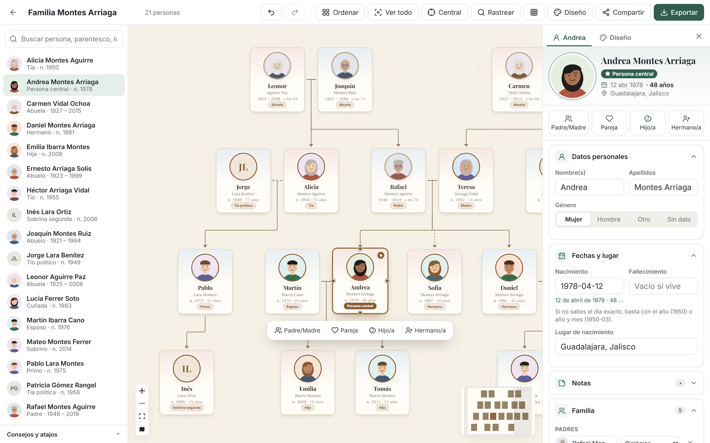
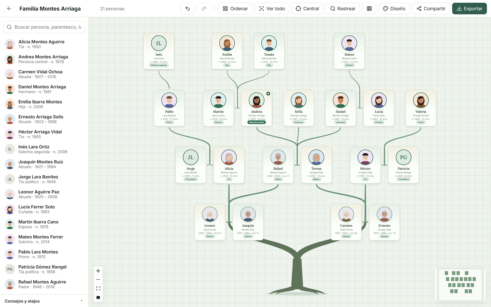
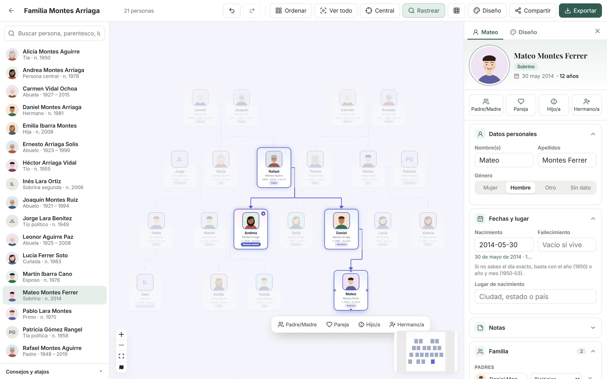
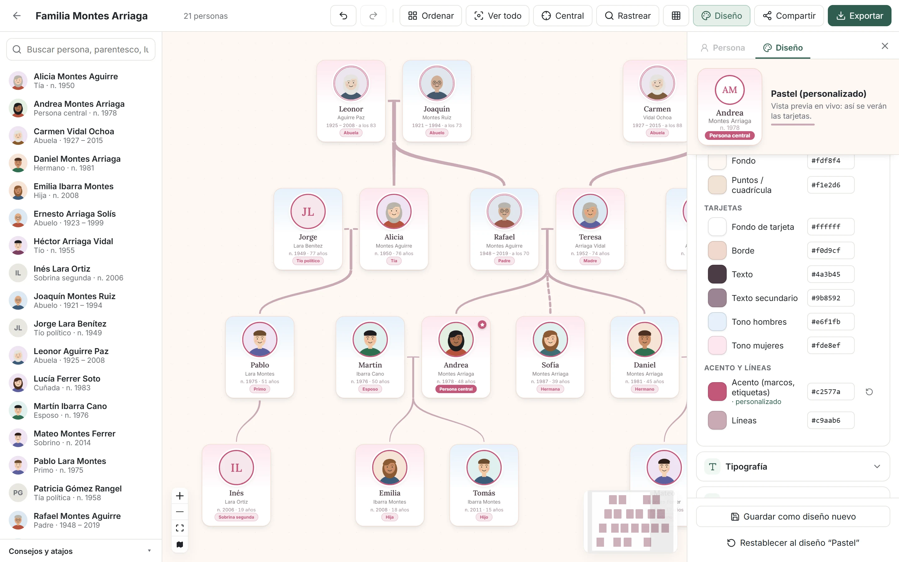
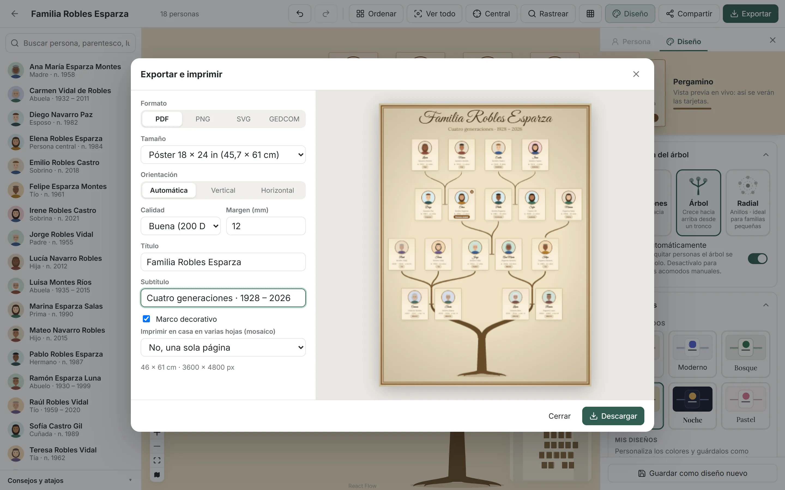
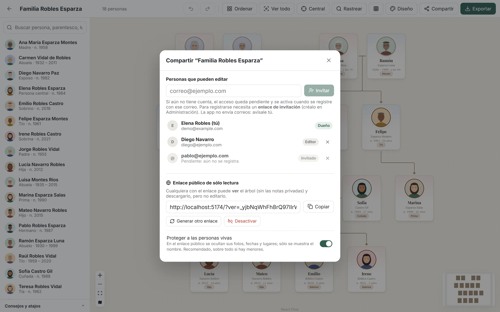
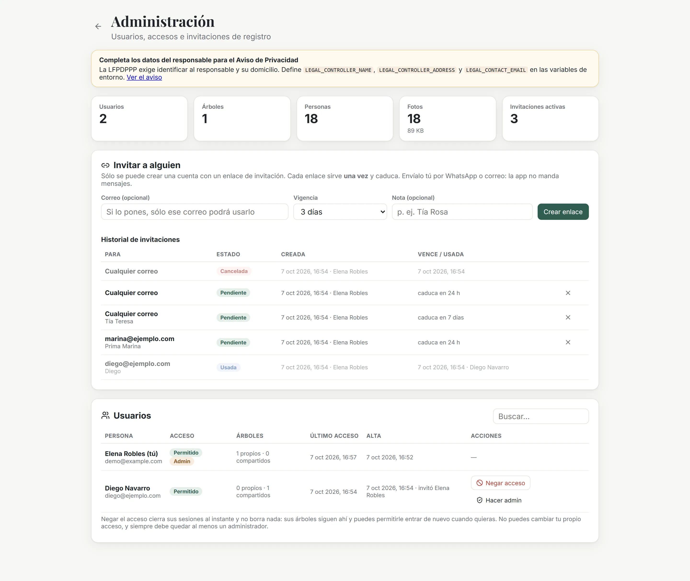
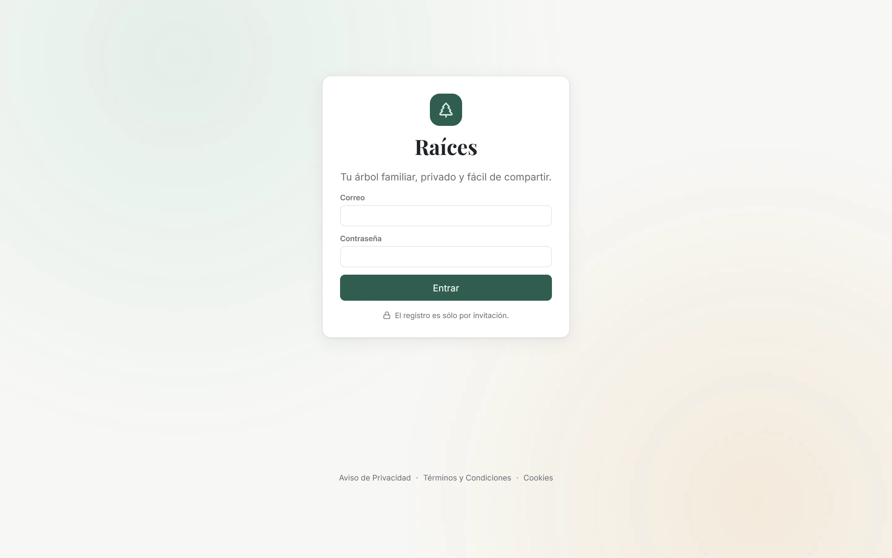
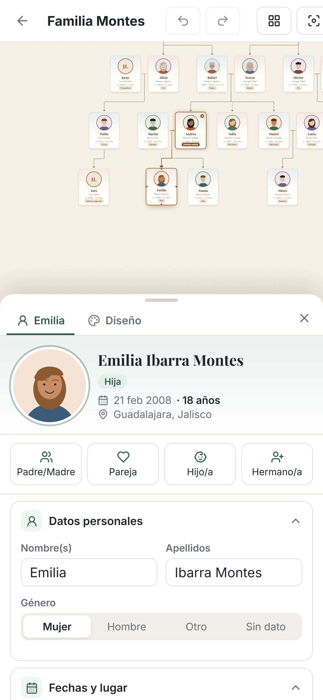

# 🌳 Raíces — Editor de árboles genealógicos

Aplicación web para crear, organizar, compartir e imprimir árboles familiares en un **lienzo infinito**: tarjetas con foto que se arrastran libremente, conexiones que se trazan con el ratón, parentescos que se calculan solos y exportación lista para imprenta, desde una hoja carta hasta un póster A0.




> Todas las capturas usan una **familia inventada** con retratos ilustrados; no contienen datos reales.

<table>
  <tr>
    <td width="50%"><br><sub><b>Modo Árbol</b>: los ancestros sobre un tronco y los descendientes en ramas.</sub></td>
    <td width="50%"><br><sub><b>Rastreo</b>: el camino que une a una persona con la persona central.</sub></td>
  </tr>
  <tr>
    <td><br><sub><b>Diseño</b>: vista previa en vivo y personalización de cada color.</sub></td>
    <td><br><sub><b>Exportación</b>: pósters y hojas listos para imprimir.</sub></td>
  </tr>
  <tr>
    <td><br><sub><b>Compartir</b>: editores y enlace público de solo lectura.</sub></td>
    <td><br><sub><b>Administración</b>: usuarios e invitaciones de un solo uso.</sub></td>
  </tr>
  <tr>
    <td><br><sub><b>Acceso</b>: registro solo por invitación.</sub></td>
    <td align="center"><br><sub><b>Móvil</b>: la ficha se abre como hoja inferior.</sub></td>
  </tr>
</table>

---

## Índice

- [El problema](#el-problema)
- [Funcionalidades](#funcionalidades)
- [Stack tecnológico](#stack-tecnológico)
- [Arquitectura](#arquitectura)
- [Decisiones técnicas destacadas](#decisiones-técnicas-destacadas)
- [Modelo de datos e integridad](#modelo-de-datos-e-integridad)
- [Seguridad y privacidad](#seguridad-y-privacidad)
- [Protección de datos personales (México)](#protección-de-datos-personales-méxico)
- [Ejecutar en local](#ejecutar-en-local)
- [Pruebas y CI](#pruebas-y-ci)
- [Despliegue en producción](#despliegue-en-producción)
- [Estructura del proyecto](#estructura-del-proyecto)
- [Hoja de ruta](#hoja-de-ruta)
- [Licencia](#licencia)

---

## El problema

Armar un árbol genealógico en herramientas de diseño genéricas resulta engorroso: el lienzo se corta, el zoom no acompaña, las líneas hay que dibujarlas a mano y cada cambio obliga a reacomodar todo. Las plataformas de genealogía, por su parte, se centran en la investigación y no en producir una pieza visual cuidada para imprimir o regalar.

**Raíces** combina ambas cosas: un editor visual tan directo como una pizarra y un modelo de datos genealógico real que se encarga de las relaciones, del orden y de los parentescos.

## Funcionalidades

### Edición en el lienzo
- **Lienzo infinito** con zoom, desplazamiento, minimapa y selección múltiple; las tarjetas se mueven como objetos en un plano.
- **Crear familiares arrastrando**: desde el borde inferior de una tarjeta nace un hijo, desde el superior un padre y desde un lateral una pareja. También hay botones rápidos y vinculación de personas existentes.
- **Parentescos automáticos** respecto a una persona central: padres, abuelos, bisabuelos, tíos, primos, sobrinos, primos segundos, medios hermanos, cuñados, suegros, yernos, padrastros, hijastros y familia política.
- **Rastreo de linaje**: al seleccionar a alguien se resalta el camino que lo une con la persona central, con un modo que atenúa al resto.
- **Deshacer / rehacer** completo (`Ctrl+Z` / `Ctrl+Y`) de creaciones, borrados, ediciones, movimientos, vínculos y cambios de diseño.
- **Borrado seguro**: `Supr` elimina personas o vínculos (haciendo clic en una línea), siempre con opción de deshacer.

### Organización automática
Tres formas de presentar el árbol, todas generadas automáticamente y luego ajustables a mano:

| Generaciones | Árbol | Radial |
|---|---|---|
| Clásico de arriba hacia abajo: parejas juntas, hijos centrados bajo sus padres y líneas en "T". | Los ancestros sobre un **tronco con raíces** que se ramifica hacia el origen de cada linaje, y los descendientes creciendo hacia arriba en **ramas que se afinan**. | Medallones en anillos concéntricos, desde los ancestros hacia las generaciones más recientes (ideal para familias pequeñas). |

- **Orden automático**: al agregar o quitar personas o vínculos el árbol se reacomoda solo y las tarjetas **se deslizan** a su nuevo lugar; se puede desactivar para conservar acomodos manuales.
- Probado con árboles de 5 generaciones, varios linajes que se unen por matrimonio y familias numerosas.

### Diseño
- Seis estilos prediseñados (Clásico, Moderno, Bosque, Pergamino, Noche y Pastel).
- **Personalización total**: cada color (fondo, tarjetas, bordes, textos, acento, líneas, tonos por género), tipografías, esquinas, forma de la foto, estilo de líneas y patrón de fondo.
- **Avisos de legibilidad** basados en el contraste WCAG.
- **Diseños propios** guardados por usuario y reutilizables en todos sus árboles.

### Fotos
- Recorte, zoom y rotación en el navegador; la imagen se reduce a 600×600 px en WebP (≈50 KB) antes de subirla, de modo que siempre encaja en la tarjeta.
- Basta con arrastrar una foto sobre una tarjeta.

### Exportación e impresión
- **PDF, PNG y SVG** con título, subtítulo, márgenes, marco decorativo y vista previa.
- Tamaños Carta, Oficio, A4, Tabloide, A3–A0 y pósters de 18×24 y 24×36 pulgadas, entre 120 y 300 DPI.
- **Mosaico**: divide un póster en hojas Carta o A4 con zonas de solape y guías para imprimirlo en casa y unirlo.
- **GEDCOM 5.5.1**: importación y exportación en el formato estándar de genealogía (Ancestry, MyHeritage, FamilySearch, Gramps).

### Colaboración
- **Cuentas de usuario** con registro solo por invitación.
- **Compartir** un árbol con otros usuarios como editores.
- **Edición en tiempo real**: los cambios de otros editores aparecen al instante, junto con quién está conectado.
- **Enlace público de solo lectura**, revocable, que oculta las notas privadas.
- **Panel de administración**: gestión de usuarios (permitir o negar el acceso, roles) e invitaciones de registro de un solo uso con caducidad.

### Interfaz
- Panel lateral único con pestañas (persona / diseño); en el celular se convierte en una hoja inferior.
- Diseño adaptable a escritorio, tableta y móvil.

## Stack tecnológico

| Capa | Tecnología | Uso |
|---|---|---|
| Frontend | **React 18 + TypeScript + Vite** | Interfaz y compilación |
| Lienzo | **React Flow (@xyflow/react)** | Grafo interactivo: zoom, arrastre, conexiones |
| Estado | **Zustand** | Estado global e historial de comandos |
| Layout | **dagre** + algoritmos propios | Orden automático por generaciones, tronco y radial |
| Exportación | **html-to-image + jsPDF** | Render a PNG/SVG/PDF y mosaico |
| Backend | **Node.js 20 + Fastify 5** | API REST y canal en tiempo real (SSE) |
| Validación | **Zod** | Validación de todas las entradas |
| Base de datos | **PostgreSQL 16** (`pg`) | Datos, reglas de integridad y notificaciones (`LISTEN/NOTIFY`) |
| Archivos | **Cloudflare R2** (API S3) | Almacenamiento de fotos sin coste de salida |
| Infraestructura | **Docker + Railway** | Imagen única que sirve API y frontend |

## Arquitectura

```
                Navegador
 ┌──────────────────────────────────────────────┐
 │  React + React Flow                          │
 │  · lienzo, layouts, parentescos, exportación │
 │  · recorte y compresión de fotos             │
 └──────────────┬───────────────────────────────┘
                │ HTTPS (JSON) · cookie de sesión · SSE
 ┌──────────────▼───────────────────────────────┐
 │  Fastify (un solo servicio)                  │
 │  · autenticación, autorización por árbol     │
 │  · validación, transacciones                 │
 │  · sirve también el frontend compilado       │
 └───────┬──────────────────────────┬───────────┘
         │                          │
   PostgreSQL 16              Cloudflare R2
   datos + reglas + NOTIFY    fotos (WebP)
```

El frontend y la API se publican desde **un único servicio y un único origen**. Eso abarata el hosting, simplifica el despliegue y elimina la necesidad de CORS para la API.

## Decisiones técnicas destacadas

**Solo se almacenan relaciones primarias.**
La base de datos guarda únicamente *padre→hijo* (con tipo: biológico, adoptivo, padrastro o acogida) y *pareja* (con estado). Abuelos, tíos, primos o cuñados **se derivan** buscando el ancestro común más cercano y contando generaciones hacia arriba y hacia abajo. Así ningún parentesco puede quedar desincronizado.

**Nodos de "unión" para el dibujo clásico.**
Cada pareja tiene un nodo invisible en su punto medio, del que bajan las líneas hacia los hijos. Así se obtiene la forma en "T" característica de los árboles genealógicos. El nodo se recalcula mientras se arrastra a cualquiera de los dos.

**Layout propio sobre dagre.**
dagre propone el orden horizontal y, encima, varias pasadas propias:
- asignación de generaciones,
- parejas tratadas como un bloque,
- cada persona del lado de sus propios padres,
- iteraciones que centran a los hijos bajo los padres y a los padres sobre los hijos.

Los modos "Árbol" y "Radial" transforman ese resultado (inversión vertical y conversión a coordenadas polares) y dibujan las ramas como polígonos de grosor variable.

**Historial de comandos con identificadores estables.**
Cada acción registra cómo deshacerse y rehacerse. Los borrados guardan una instantánea que el servidor reinserta **con los mismos UUID**, de modo que el resto del historial sigue siendo válido.

**Colaboración con Server-Sent Events + PostgreSQL `LISTEN/NOTIFY`.**
- Cada cambio confirmado emite una notificación en la base; el servidor la reenvía a las pestañas abiertas de ese árbol.
- La pestaña que originó el cambio se identifica (`X-Client-Id`) y no se recarga a sí misma.
- El diseño funciona aunque se ejecuten varias réplicas del servidor.

**Fotos procesadas en el cliente.**
El recorte y la compresión ocurren en el navegador, así que el servidor no necesita dependencias nativas de imagen y el almacenamiento crece muy despacio. Cada subida queda registrada, y un proceso periódico borra las fotos que nadie usa tras un periodo de gracia (que permite deshacer).

**Guardado diferido del diseño.**
Los cambios de diseño se aplican al instante en pantalla y se guardan en el servidor 400 ms después del último. Arrastrar un selector de color no genera cientos de peticiones.

## Modelo de datos e integridad

Las reglas genealógicas viven **en la propia base de datos**, mediante restricciones y *triggers*, de modo que se cumplen aunque la aplicación tuviera un error:

- **Sin ciclos:** nadie puede ser su propio ancestro (CTE recursiva en un *trigger*).
- **Máximo dos progenitores biológicos** por persona.
- **Coherencia de vínculos:** un progenitor y su hijo no pueden ser pareja, y nadie puede ser su propio padre.
- **Aislamiento entre árboles:** las relaciones nunca cruzan de un árbol a otro (claves foráneas compuestas `(id, tree_id)`).
- **Parejas sin duplicados** gracias a un orden canónico más una restricción `UNIQUE`.
- **Validaciones de datos:** fechas coherentes (fallecimiento posterior al nacimiento), con precisión de año, mes o día.
- **Exactamente un dueño por árbol** (índice único parcial).
- **Operaciones compuestas transaccionales:** crear una persona con sus vínculos o importar un GEDCOM completo es todo o nada.

Las migraciones SQL se versionan en `server/migrations/` y se aplican automáticamente al arrancar.

## Seguridad y privacidad

- **Autenticación propia**, sin proveedores externos. Las contraseñas se derivan con **scrypt** y sal individual.
- **Sesiones:**
  - viajan en una cookie `HttpOnly; Secure; SameSite=Lax`;
  - en la base solo se guarda el hash SHA-256 del token;
  - cerrar sesión o bloquear a un usuario las invalida de inmediato.
- **Protección del inicio de sesión:**
  - límite de intentos por IP;
  - tiempo de respuesta constante, para que no se pueda averiguar qué correos tienen cuenta.
- **Registro solo por invitación:**
  - enlaces de un solo uso, con caducidad y, opcionalmente, ligados a un correo;
  - se consumen de forma atómica y solo se almacena su hash.
- **Autorización en el servidor** en cada petición a un árbol. Sin permiso, la respuesta es `404`, para no revelar que el árbol existe.
- **Enlaces públicos:**
  - tokens aleatorios de 144 bits, revocables;
  - excluyen las notas privadas.
- **Fotos:** se guardan con nombres aleatorios (UUID), que no se pueden listar ni adivinar.
- **HTTPS obligatorio** en producción (redirección 301) y cabeceras de seguridad: `Strict-Transport-Security`, `Content-Security-Policy` estricta (sólo recursos propios y el dominio de las fotos), `X-Frame-Options: DENY`, `X-Content-Type-Options`, `Referrer-Policy` y `Permissions-Policy`.
- Los secretos se gestionan únicamente mediante variables de entorno (`.env` está excluido del repositorio).

## Protección de datos personales (México)

La aplicación incorpora los elementos que exige la **Ley Federal de Protección de Datos Personales en Posesión de los Particulares (LFPDPPP)**:

| Requisito | Implementación |
|---|---|
| Aviso de Privacidad integral | Página `?legal=privacidad`: identidad y domicilio del responsable, datos tratados, finalidades (sólo primarias, sin mercadotecnia), datos sensibles, transferencias y remisiones, medios ARCO y plazos, revocación, cookies, medidas de seguridad, conservación, cambios y autoridad. |
| Consentimiento expreso e informado | El registro exige dos casillas: aceptación del Aviso y los Términos, y confirmación de mayoría de edad y de contar con autorización para registrar datos de terceros. Se guarda la versión aceptada y la fecha (`consent_log`). |
| Cambios al aviso | Al cambiar `LEGAL_VERSION`, cada usuario debe aceptar la nueva versión antes de seguir usando la app (el servidor responde `428` hasta entonces). |
| Derechos ARCO | En **Mi cuenta**: descarga de todos los datos en JSON (acceso y portabilidad), corrección de nombre y contraseña (rectificación) y eliminación de la cuenta con sus árboles (cancelación y revocación). Oposición y demás solicitudes por el correo de privacidad. |
| Datos de terceros y menores | Registro sólo para mayores de edad; el usuario declara contar con autorización para registrar a otras personas. En los enlaces públicos se ocultan por defecto fotos, fechas y lugares de **personas vivas**, y crear el enlace requiere confirmar dicha autorización. |
| Datos sensibles | No se solicitan; las notas advierten no registrarlos sin consentimiento expreso. |
| Cookies | Sólo una cookie esencial de sesión y almacenamiento local de preferencias; aviso informativo y Política de Cookies (`?legal=cookies`). Sin analítica ni rastreadores. |
| Términos y Condiciones | Página `?legal=terminos`. |
| Medidas de seguridad | Ver [Seguridad y privacidad](#seguridad-y-privacidad). |

Los datos del responsable se configuran con `LEGAL_CONTROLLER_NAME`, `LEGAL_CONTROLLER_ADDRESS` y `LEGAL_CONTACT_EMAIL`; mientras falten, el aviso los muestra resaltados y el panel de administración lo advierte.

> **Importante:** estos textos son una base técnica sólida, no asesoría legal. Antes de abrir el servicio al público conviene que un abogado especialista en protección de datos los revise y adapte a tu caso.

## Ejecutar en local

**Requisitos:** Node.js 20+ y Docker.

```bash
git clone <url-del-repositorio>
cd arbol_familiar
npm install
cp server/.env.example server/.env
npm run db:up      # PostgreSQL 16 en Docker (puerto 5440)
npm run dev        # API en :3001 y aplicación en http://localhost:5173
```

La primera cuenta que se registra en una base vacía es la de **administrador**. A partir de ahí, las nuevas cuentas se crean con enlaces de invitación desde el panel de administración.

En desarrollo, las fotos se guardan en `server/uploads/`; si se definen las variables de Cloudflare R2, se usan automáticamente.

### Scripts útiles

| Comando | Descripción |
|---|---|
| `npm run dev` | API y frontend en modo desarrollo |
| `npm run build` | Compila frontend y backend |
| `npm test` | Pruebas del cliente y del servidor (ver [Pruebas y CI](#pruebas-y-ci)) |
| `npm run typecheck` | Revisa los tipos de TypeScript en cliente y servidor |
| `npm start` | Ejecuta la versión compilada (sirve API y frontend) |
| `npm run db:up` / `db:down` | Levanta o detiene PostgreSQL en Docker |
| `npm run r2:check -w server -- https://tu-dominio.com` | Verifica credenciales, escritura, lectura pública y CORS de R2 |
| `npm run r2:migrate -w server [-- --apply]` | Sube a R2 las fotos locales y actualiza sus enlaces |

## Pruebas y CI

```bash
npm run db:up   # las pruebas del servidor usan el mismo PostgreSQL de Docker
npm test
```

| Dónde | Qué se prueba | Cómo |
|---|---|---|
| `client/src/lib/*.test.ts` | Parentescos (sangre y políticos, medios hermanos, padrastros), fechas parciales y edades, GEDCOM de ida y vuelta, acomodo sin tarjetas encimadas en los tres modos | Vitest, funciones puras con una familia inventada (`client/src/test/family.ts`) |
| `server/test/integrity.test.ts` | Reglas que viven en PostgreSQL: sin ciclos, máximo dos padres biológicos, nada entre árboles distintos, fechas coherentes, importación todo o nada | La API real con `app.inject()` (sin abrir puertos) contra una base de datos real |
| `server/test/access.test.ts` | Registro sólo por invitación de un solo uso, roles, bloqueo de cuentas, 404 a quien no es miembro, consentimiento versionado (428), enlace público que oculta a las personas vivas | Igual |

Las pruebas del servidor **borran y vuelven a crear** la base `arbol_test` en cada corrida, por eso se niegan a correr si el nombre de la base (`TEST_DATABASE_URL`) no termina en `_test`: es imposible que toquen la base de desarrollo por accidente.

En cada push y pull request, [GitHub Actions](.github/workflows/ci.yml) levanta un PostgreSQL 16 de usar y tirar, revisa tipos, corre ambas suites, compila y construye la imagen Docker.

## Despliegue en producción

La configuración propuesta prioriza el **bajo coste**:

| Componente | Servicio |
|---|---|
| Aplicación (API + frontend) | **Railway**, a partir del `Dockerfile` incluido |
| Base de datos | **PostgreSQL de Railway** (red privada) |
| Fotos | **Cloudflare R2** (capa gratuita de 10 GB, sin coste de salida) |
| Dominio y DNS | **Cloudflare** |

### 1. Cloudflare R2
1. Crea un bucket y conéctale un subdominio propio (por ejemplo `fotos.tudominio.com`).
2. Añade una política CORS que permita `GET` desde el dominio de la aplicación (necesaria para incluir las fotos en las exportaciones):
   ```json
   [{ "AllowedOrigins": ["https://tudominio.com"], "AllowedMethods": ["GET", "HEAD"], "AllowedHeaders": ["*"], "MaxAgeSeconds": 86400 }]
   ```
3. Crea un token de API con permiso **Object Read & Write** limitado a ese bucket.
4. Comprueba la configuración con `npm run r2:check`.

### 2. Railway
1. Crea un proyecto desde el repositorio de GitHub; Railway detecta el `Dockerfile` y `railway.json`.
2. Añade una base de datos PostgreSQL al proyecto.
3. Define las variables de entorno del servicio:
   ```
   DATABASE_URL=${{Postgres.DATABASE_URL}}
   R2_ACCOUNT_ID=…
   R2_ACCESS_KEY_ID=…
   R2_SECRET_ACCESS_KEY=…
   R2_BUCKET=…
   R2_PUBLIC_URL=https://fotos.tudominio.com
   LEGAL_CONTROLLER_NAME=Tu nombre o razón social
   LEGAL_CONTROLLER_ADDRESS=Domicilio completo en México
   LEGAL_CONTACT_EMAIL=privacidad@tudominio.com
   ```
4. Asocia el dominio personalizado (registro CNAME en Cloudflare). El HTTPS lo proveen Railway y Cloudflare; la app redirige automáticamente cualquier acceso por HTTP.
5. Activa las copias de seguridad de PostgreSQL.

Al arrancar, el servidor aplica las migraciones y verifica el acceso a R2. Si la configuración está incompleta, se detiene con un mensaje claro en lugar de fallar más tarde.

### Variables de entorno

| Variable | Obligatoria | Descripción |
|---|---|---|
| `DATABASE_URL` | Sí | Cadena de conexión a PostgreSQL |
| `PORT` | No | Puerto HTTP (por defecto `3001`) |
| `DATABASE_SSL` | No | `true` si el proveedor exige SSL |
| `R2_ACCOUNT_ID`, `R2_ACCESS_KEY_ID`, `R2_SECRET_ACCESS_KEY`, `R2_BUCKET`, `R2_PUBLIC_URL` | En producción | Almacenamiento de fotos en Cloudflare R2 |
| `PHOTO_GRACE_DAYS` | No | Días que se conserva una foto sin uso antes de borrarla (por defecto `7`) |
| `LEGAL_CONTROLLER_NAME`, `LEGAL_CONTROLLER_ADDRESS`, `LEGAL_CONTACT_EMAIL` | En producción | Responsable del tratamiento de datos que aparece en el Aviso de Privacidad |
| `PUBLIC_SITE_URL` | No | URL pública del sitio |
| `FORCE_HTTPS` | No | `false` sólo para probar la imagen de producción en local sin certificado |

## Estructura del proyecto

```
├── client/                     Frontend (React + Vite)
│   └── src/
│       ├── components/         Lienzo, nodos, ramas, paneles, diálogos, administración
│       ├── lib/
│       │   ├── kinship.ts      Cálculo de parentescos
│       │   ├── layout.ts       Layout por generaciones, árbol y radial
│       │   ├── graph.ts        Construcción del grafo y nodos de unión
│       │   ├── branch.ts       Geometría de ramas con grosor variable
│       │   ├── export.ts       PDF / PNG / SVG / mosaico
│       │   ├── gedcom.ts       Importación y exportación GEDCOM
│       │   ├── themes.ts       Diseños, personalización y contraste
│       │   └── *.test.ts       Pruebas unitarias (Vitest)
│       └── store.ts            Estado global e historial deshacer/rehacer
├── server/                     Backend (Fastify)
│   ├── migrations/             Esquema SQL versionado
│   ├── test/               Pruebas de integración contra PostgreSQL
│   └── src/
│       ├── app.ts              Construye la app (seguridad, plugins, rutas)
│       ├── index.ts            Arranque: migraciones, limpiezas y puerto
│       ├── routes.ts           Árboles, personas, vínculos, fotos, importación
│       ├── accountRoutes.ts    Registro, sesiones, compartir, enlaces públicos
│       ├── adminRoutes.ts      Administración y diseños de usuario
│       ├── realtime.ts         Tiempo real (SSE + LISTEN/NOTIFY)
│       ├── auth.ts             Contraseñas, sesiones y permisos
│       └── storage.ts          Disco local / Cloudflare R2 y limpieza de fotos
├── .github/workflows/ci.yml   Integración continua
├── Dockerfile                  Imagen de producción (multi-etapa)
├── docker-compose.yml          PostgreSQL para desarrollo
└── railway.json                Configuración de despliegue
```

## Hoja de ruta

- Recuperación de contraseña y verificación de correo.
- Historial de deshacer persistente entre sesiones.
- Vistas filtradas ("ancestros de…" / "descendientes de…") para árboles muy grandes.

## Licencia

Distribuido bajo la licencia [MIT](LICENSE). © 2026 Mario Gaytan.

El lienzo usa [React Flow](https://reactflow.dev) (MIT, © webkid GmbH); su atribución se muestra en el lienzo, como piden sus autores para proyectos sin la suscripción Pro.
